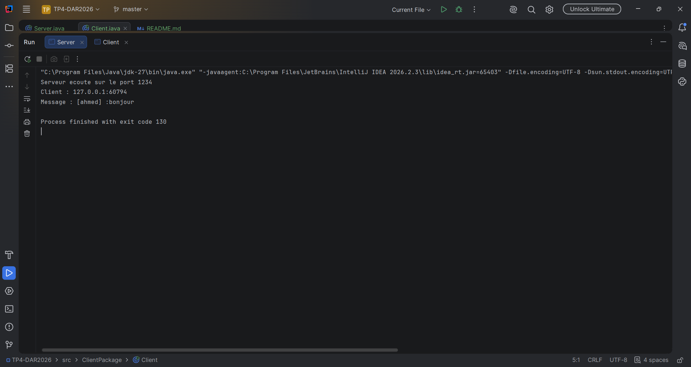
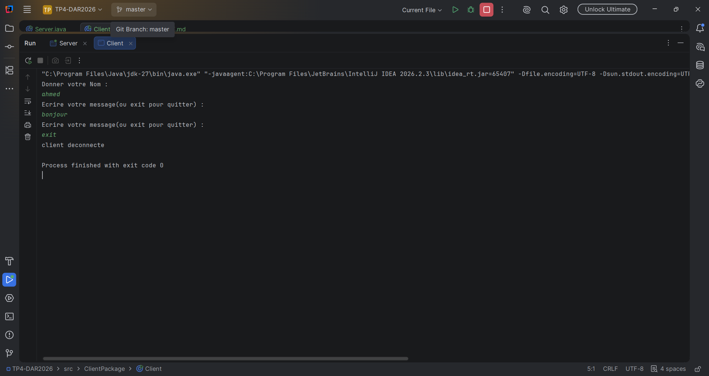

# TP4 : Sockets en mode non-connecté UDP 

## Étape 2 : Chat Unidirectionnel et Test avec un Seul Client

Le serveur écoute sur le port **1234** avec un `DatagramSocket` lié via `InetSocketAddress`. Le client saisit un nom d'utilisateur, puis envoie chaque message sous forme de `DatagramPacket` au format `[NomUtilisateur] : message`. Le serveur reçoit chaque datagramme avec `receive()` et affiche l'adresse de l'expéditeur et le contenu du message.

### Exécution

**Serveur**

**Client**

### Synthèse

- Communication en mode non-connecté : pas de `accept()`, chaque datagramme est indépendant.
- Communication unidirectionnelle : seul le client envoie, le serveur ne répond pas.
- UDP ne garantit ni la livraison ni l'ordre des messages.