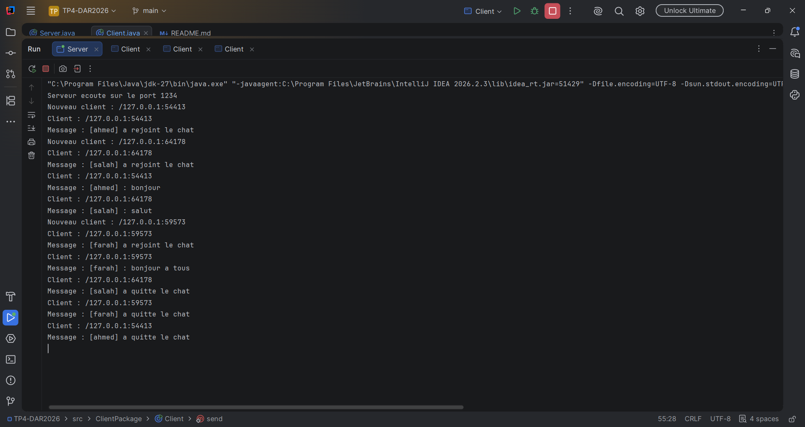
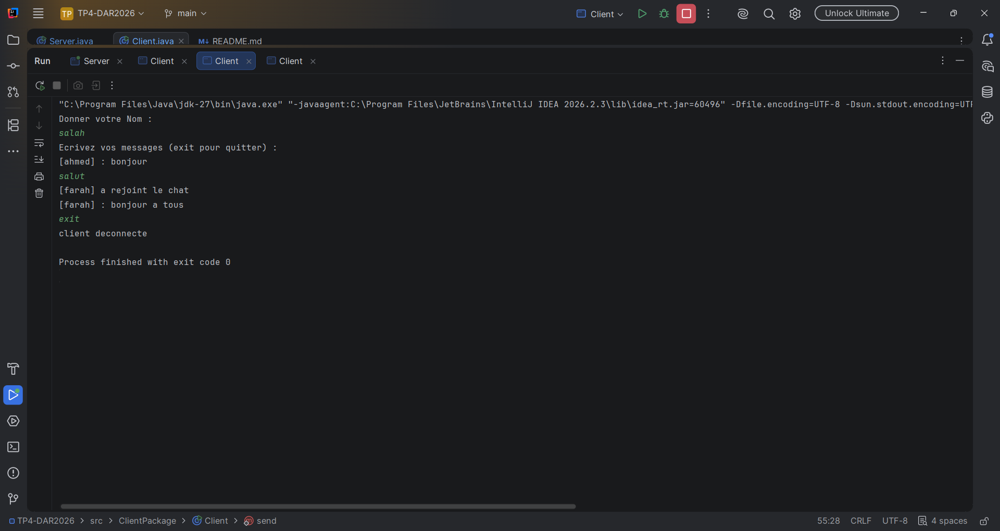
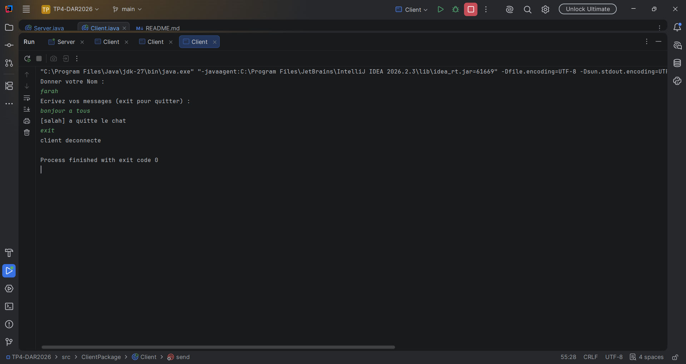

## Étape 3 : Chat bidirectionnel et diffusion

Le serveur mémorise l'adresse de chaque client qui lui écrit, puis retransmet chaque message à tous les autres clients, sauf à l'expéditeur. Côté client, un thread dédié à la réception permet d'envoyer et de recevoir en même temps.

### Exécution

**Serveur**

**Client 1**

**Client 2**

**Client 3**

### Synthèse

- Le serveur enregistre chaque nouveau client et diffuse ses messages aux autres.
- Un client ne reçoit jamais ses propres messages.
- Les messages s'affichent en temps réel grâce au thread de réception.